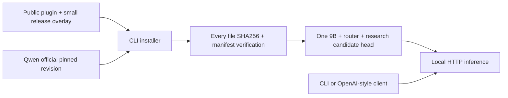

# GitHub standalone deployment plugin

## Goal and scope
External users can clone a public repository, pip install, reconstruct the verified frozen-base research bundle from public assets, serve it on a CUDA machine, and call auto/jev/llm with effort. Backend: Transformers, not native vLLM. Existing user authorization: complete external GitHub integration.

## Architecture

## Distribution and file changes
Separate clean repository xDAN-JEV-Plugin, worktree plugin-github-release. No private monorepo history, source datasets, credentials or server addresses. Files: pyproject.toml; src/xdan_jev_plugin/{cli,bundle}.py; assets/research-r1 (allowlisted manifest assets excluding verified base); tests; README; LICENSE/NOTICE; tasks/todo.md; tasks/plugin-github-release/handoff.md.

## Contracts
CLI prepare --output DIR downloads only pinned verified_base_files using huggingface_hub; copies overlay, verifies all manifest digests before atomic rename. Existing complete output can be verified/resumed; never overwrite mismatched files. CLI verify, serve, chat. serve wraps the exact hash-bound bundled serve.py; localhost default. chat accepts JSON request file, modes stay in JSON fields, never HTTP headers. Candidate quality approval remains false.

## Validation gates
1. Manifest-backed explicit export; source license and secret/path scan.
2. Unit tests: tampered files, traversal, incomplete downloads, clean CLI install.
3. Full ruff check and ruff format --check before every push.
4. Real GPU: install distribution, verify reconstructed bundle, HTTP inference through CLI against research service; record exact scope.
5. Public anonymous git clone and installation; verify public upstream asset availability.

## Known limits
Head 182/500 vs original LM 327/500 on exposed regression, not production approved. Legacy prompt.v2 candidate recovery only. Natural generalization, independent quality/retention, streaming, batching, native vLLM remain unverified/unsupported. Software publication is not completion of the model-quality goal.
